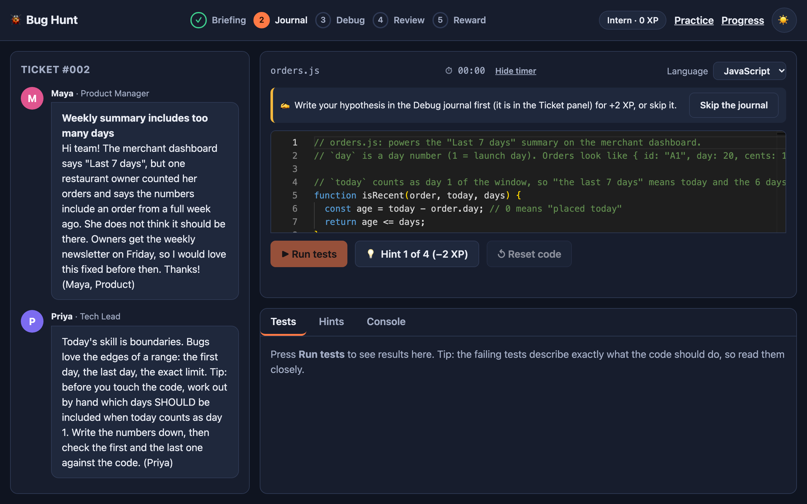
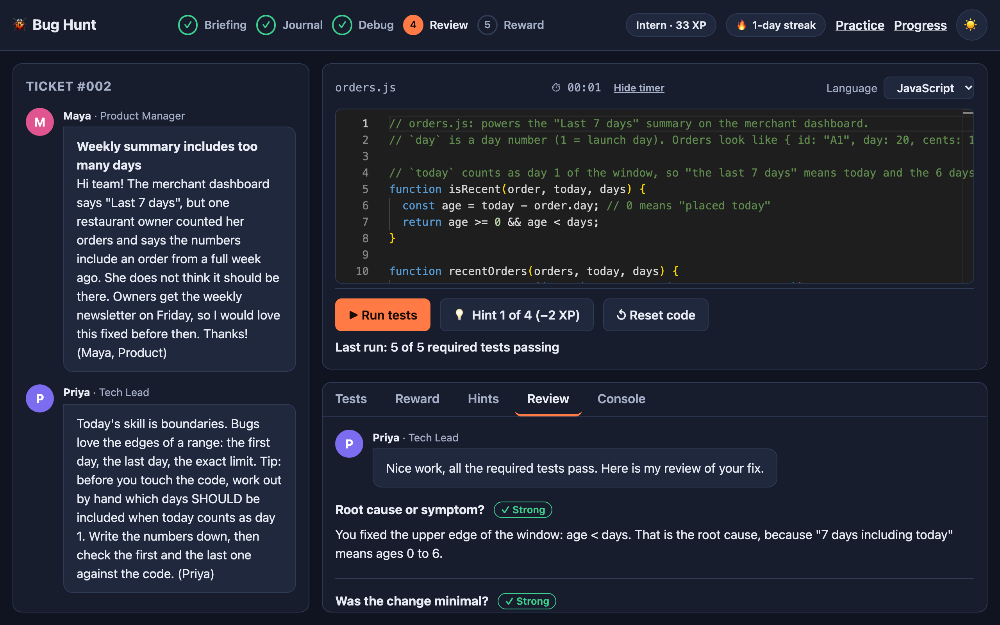
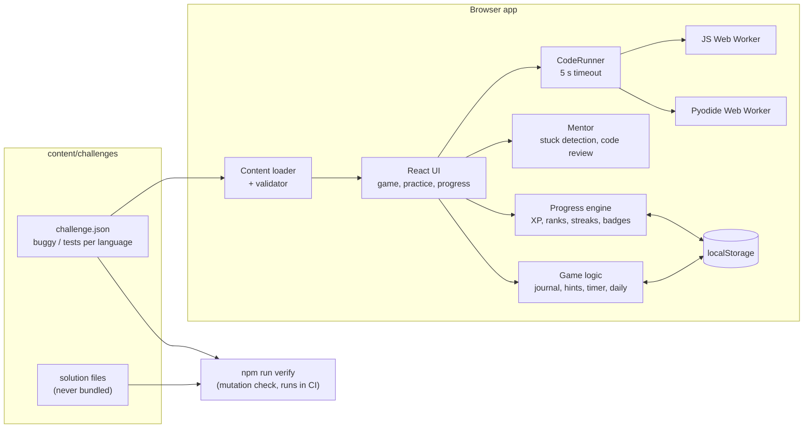

# 🐞 Bug Hunt

[](https://github.com/Barrientosgers/bug-hunt/actions/workflows/ci.yml)
[](https://github.com/Barrientosgers/bug-hunt/actions/workflows/deploy.yml)
[](LICENSE)

**A daily debugging game for junior developers. Think "Wordle meets a real engineering job".**

You are the new engineer at **Snackr**, a fictional food-delivery startup. Each bug arrives as a
realistic ticket from Leo (support), Maya (product) or Priya (your tech lead). Reproduce it, form
a hypothesis, fix the code, and learn a debugging skill along the way. Pick JavaScript or Python
from a dropdown; everything runs in your browser, with no sign-up.

### ▶ [Play it now](https://barrientosgers.github.io/bug-hunt/)

<p>
  
  
</p>

_Left: a ticket, the buggy code and the hint button. Right: after the fix, Priya reviews it._

## How a challenge works

1. **Briefing:** a ticket written like a real bug report (sometimes vague, so reproducing it is
   part of the skill), plus one tip from Priya about the skill it practices.
2. **Debug journal:** write a hypothesis ("I think the bug is in ___ because ___") before you
   edit anything. It earns bonus XP, and the review at the end tells you how close you were.
3. **Code and tests:** a real editor (the one from VS Code) with the buggy code, a **Run tests**
   button, expected-versus-got results and a console panel.
4. **Hint ladder:** four levels that teach debugging _methods_ (read the failing test, inspect
   the data, understand the concept, full explanation). Hints cost a little XP, but solving
   still counts.
5. **Stuck detection:** after repeated failed runs or a long time without progress, Priya
   gently offers help. You can say no.
6. **Code review:** after you solve it, the mentor reviews _your_ fix: root cause or symptom,
   how minimal the change was, bonus findings, and feedback on your journal hypothesis. Then
   come "how to prevent it", "where this shows up at work" and one lesson to keep.
7. **Reward:** a flag like `BUGHUNT{snackr-001-js-xxxxxx}`, an XP breakdown, rank progress,
   skill points, badge progress and a Wordle-style share card with no spoilers.

There is a new **daily bug** (the same one for everyone, picked from the calendar date, no
server needed), a **practice library** of every bug, and a **progress page** with your streak, a
solved-days heatmap, a skill map per category and language, and badges.

### Hints and mentor philosophy

Getting stuck is normal, so the tone is encouraging and never shaming. Praise goes to good
debugging _process_, not only the final fix. The mentor never jumps to the answer: hints build
the habit of reading evidence first. Help is always available, and asking for it never blocks
progress.

## How challenges are verified (the mutation check)

A bug game is only fun if every bug is fair. Each challenge ships with a reference solution
and a test suite, and `npm run verify` runs a **mutation check** on every challenge and language:

- the **reference solution passes every test**, and
- the **buggy version fails at least one required test** (so the bug is real and the tests
  catch it), and
- the code-review rules fire on the right code, and the solution is a small change.

CI runs this on every push, so a broken challenge can never ship or be deployed.

## Security

- Player code runs **only inside Web Workers, with a timeout**. There is no `eval` on the main
  page, and a runaway loop is stopped by terminating the worker.
- Reference solutions are **never bundled** into the browser build. Only the buggy starter code
  and the tests are reachable by the app.
- There are no accounts, secrets or personal data. The game stores progress in your browser's
  `localStorage` (always wrapped in `try/catch`, so it works even when storage is blocked).
- Dependency audit: an `overrides` entry in `package.json` pins `dompurify` to a patched version.

## Tech stack

| Area       | Choice                                          | Why                                                            |
| ---------- | ----------------------------------------------- | -------------------------------------------------------------- |
| App        | React 19, TypeScript 6.0, Vite 8                | Fast dev loop and typed code                                   |
| Editor     | Monaco (`@monaco-editor/react`)                 | The real VS Code editor, loaded from a CDN at a pinned version |
| JavaScript | Web Worker sandbox with a timeout               | Safe execution of player code                                  |
| Python     | Pyodide (Python in WebAssembly) in a Web Worker | Python in the browser with no server                           |
| Styling    | Plain CSS with variables and CSS Modules        | Design tokens, dark and light themes, no framework             |
| Tests      | Vitest                                          | Fast unit tests for all game logic                             |
| Quality    | ESLint, Prettier, GitHub Actions                | Lint, format, tests and the mutation check on every push       |
| Hosting    | GitHub Pages, deployed by GitHub Actions        | Free, and nothing to run on a server                           |

TypeScript is pinned to 6.0 because `typescript-eslint` does not support TypeScript 7 yet.

## Architecture

All game logic is written as small **pure functions** (journal, hints, stuck detection, code
review, XP, ranks, streaks, daily selection) with unit tests. React components stay thin.



Routing uses the URL hash (`#/`, `#/play/<id>`, `#/practice`, `#/progress`), so it works on
GitHub Pages without any server setup.

Challenge format: each challenge is a folder under `content/challenges/` with a
`challenge.json` (ticket, briefing, hints per language, review rules, lesson, bonus tests) and
per-language `buggy`, `solution` and `tests` files. A validator checks the format when the app
loads them, and the mutation check checks them again in CI.

## The challenges so far

| #   | Bug                                                          | Skill        |
| --- | ------------------------------------------------------------ | ------------ |
| 001 | The leaderboard puts "95" above "120" (strings, not numbers) | Data types   |
| 002 | "Last 7 days" counts 8 days (off-by-one)                     | Loops        |
| 003 | Free delivery is not free at exactly $25 (`>` vs `>=`)       | Conditions   |
| 004 | The FIVEOFF promo shows `$NaN` (a missing `return`)          | Control flow |
| 005 | Receipt totals are off by a tiny amount (floating-point)     | Math         |

Each one exists in both JavaScript and Python.

## Run it locally

You need Node 24 and, for `npm run verify`, `python3`.

```bash
npm install
npm run dev
```

| Command                | What it does                                                               |
| ---------------------- | -------------------------------------------------------------------------- |
| `npm run dev`          | Start the dev server                                                       |
| `npm run build`        | Type-check and build                                                       |
| `npm run lint`         | Lint with ESLint                                                           |
| `npm run format:check` | Check formatting with Prettier                                             |
| `npm test`             | Run unit tests with Vitest                                                 |
| `npm run verify`       | Mutation check: every challenge's solution passes and its buggy code fails |

The editor and the Python runtime load from the jsDelivr CDN, so you need an internet
connection to play.

## Honest notes

- **Challenges are written with AI assistance** and reviewed by the project owner. Every one
  is verified by the mutation check above. The Snackr code and bugs are fictional.
- **Flags are for personal progress only.** In this version, flags such as `BUGHUNT{...}` are
  generated in your browser and are not tamper-proof. Leaderboard flags will later be issued by
  a server that re-runs the official tests, so points cannot be faked.
- **Hints and review rules ship inside the page.** A determined player could read them in the
  browser's developer tools. That is an accepted limit for a practice game with no prizes.
  Reference solutions are not shipped.

## Roadmap

Real debugging is a loop: **Reproduce, Locate, Fix, Prevent**. Today the game trains "Fix".
Planned next, roughly in this order:

1. **Warm-ups:** 30-second "what does this print?" puzzles, a daily habit that keeps streaks alive.
2. **Code Review mode:** Priya sends a small pull request; you click the bad line and explain why.
3. **QA and Trace modes:** write a bug report from a fake Snackr page, then trace the wrong function
   with a simulated DevTools panel.
4. **Bisect mode:** find the commit that broke it in a mini git history.
5. **UX and accessibility bugs:** contrast, missing labels, double submits, focus traps.
6. **Data and SQL bugs.**
7. **More languages** through a code execution server.
8. **Accounts, server-verified flags and leaderboards.**
9. **Real-world replays:** small, self-contained versions of real open-source bugs, clearly labeled
   and credited.

## Built by

[Gerson Barrientos](https://github.com/Barrientosgers), as a portfolio project, built step by step
with Claude Code as a pair-programming partner.

## License

[MIT](LICENSE)
